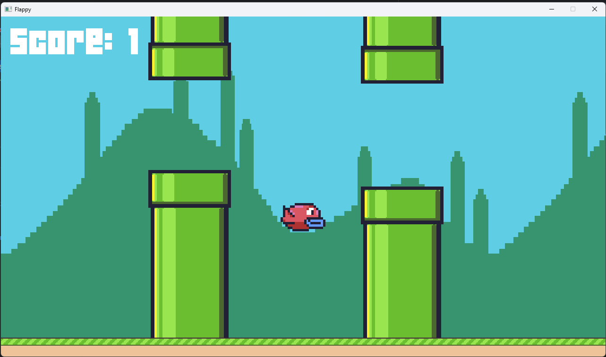

# Raylib Flappy

this repository contains an implementation of the famous Flappy bird game using
[Golang](https://go.dev/) and [Raylib](https://www.raylib.com/index.html).

## Perquisites

- golang 1.25.12
- make

## How to run

clone the repos using git:
```shell
git clone https://github.com/lazyboy81/Flappy-Raylib
```
then go into the repo directory:
```shell
cd ./Flappy-Raylib
```
And finally run the following to lunch the game:
```shell
make run
```

## The game loop


You start in the title screen, then when pressing 'enter' key you can play the game.

flappy goes up using 'space', if you hit the ground or the pipes you lose.

## mechanics

- create a virtual resolution using `RenderTexture2D`. see [main](main.go)
- background movement and animation. see [main](main.go)
- hit boxes. see [main](main.go)
- states and state machines. see [state](state) package
- playing sounds and musics. see [main](main.go)